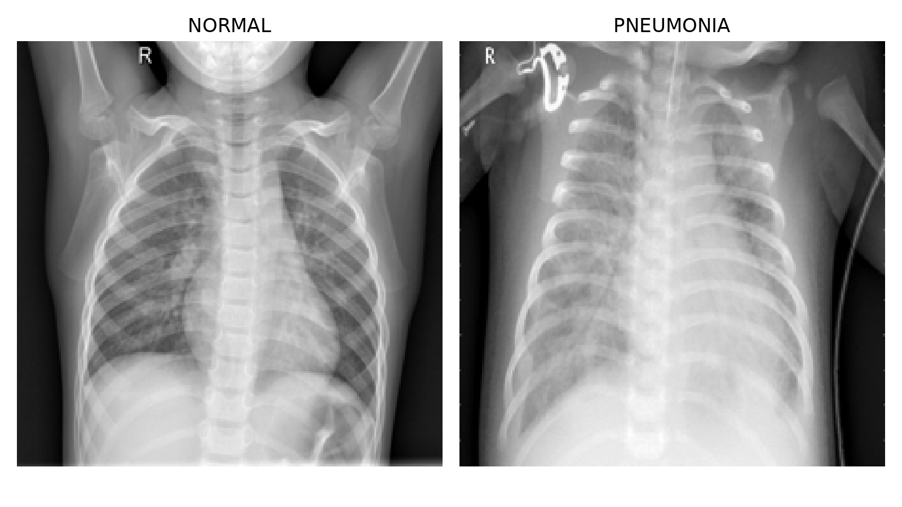
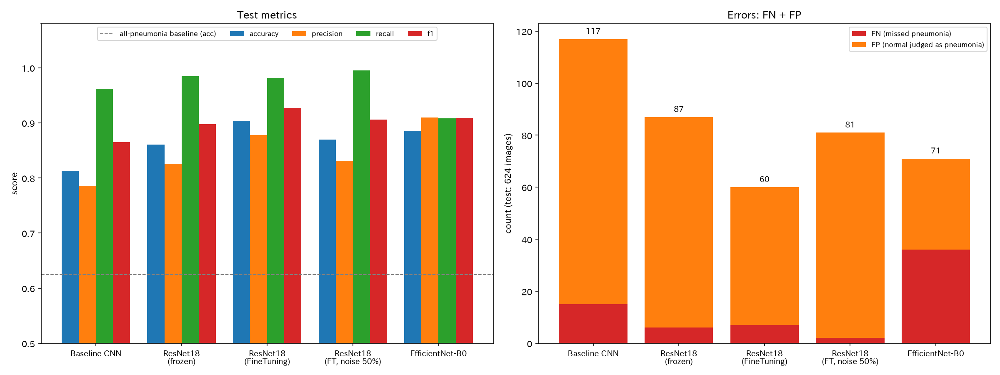

# 胸部X線画像による肺炎分類（社内PoC）

> **注意**：本プロジェクトは、公開データセットを使った画像分類パイプラインの検証であり、医療診断や臨床利用を目的としたものではない。

## 1. プロジェクト概要

胸部X線画像から肺炎の有無を判定する二値分類モデルを、社内PoCとして検証した。目的は高いAccuracyを出すことではなく、データ確認、前処理、モデル比較、評価、推論速度の検証までを、**再現性のある形で一通り実装できるか**を確かめることである。

## 2. 使用データセット

Kaggle [Chest X-Ray Images (Pneumonia)](https://www.kaggle.com/datasets/paultimothymooney/chest-xray-pneumonia/data)

| 分割 | NORMAL | PNEUMONIA | 合計 |
|---|---:|---:|---:|
| train | 1,341 | 3,875 | 5,216 |
| val | 8 | 8 | 16 |
| test | 234 | 390 | 624 |

- PNEUMONIAがNORMALの約3倍あり、**クラス不均衡**がある。そのため、Accuracyだけでは評価できない（すべてを「肺炎」と答えるだけでも、testでAccuracy 0.625になる）。
- valは16枚しかないため、モデルの比較には用いていない。



## 3. 実行環境

- Python 3.11.14（pyenv）、CPU
- 主要ライブラリ：PyTorch 2.15.0、torchvision 0.29.2、onnx 1.23.2、onnxruntime 1.32.0
- バージョンを固定した一覧は `requirements-lock.txt` を参照

```bash
cd 01_chest-xray-pneumonia-calssification
~/.pyenv/versions/3.11.14/bin/python -m venv .venv
source .venv/bin/activate
pip install -U pip
pip install -r requirements-lock.txt
```

※ `.venv` は作成した場所の絶対パスを内部に保持するため、プロジェクトのフォルダを移動した場合は作り直す必要がある。

## 4. ディレクトリ構成

```text
01_chest-xray-pneumonia-calssification/
├── README.md
├── requirements.txt          # 主要ライブラリ
├── requirements-lock.txt     # バージョン固定版
├── images/                   # READMEで使う図
├── notebooks/
│   ├── data/                 # データセット(train / val / test)
│   ├── pneumonia_classification.ipynb   # EDAと初期の実験
│   └── quantization_benchmark.ipynb     # 量子化の検証
├── src/
│   ├── dataset.py            # データ読み込み・前処理・DataLoader
│   ├── models.py             # 3モデルの定義とoptimizerの設定
│   ├── train.py              # 学習ループ
│   ├── evaluate.py           # 評価(Accuracy / Precision / Recall / F1、誤分類の取得)
│   ├── utils.py              # パラメータ数の集計など
│   ├── main.py               # 学習〜評価を1コマンドで実行
│   ├── benchmark.py          # 推論時間・モデルサイズの測定
│   ├── visualize.py          # モデル比較グラフの作成
│   └── PR_curve.py           # 閾値を変えたときのFN / FPの比較
└── outputs/
    └── models/               # 学習済みモデル(.pth)、量子化モデル(.onnx)
```

※ `outputs/` と `notebooks/data/` は `.gitignore` で除外している。データはKaggleから取得して `notebooks/data/` に配置する。`outputs/` はスクリプトを実行すると再生成される。

## 5. 実行手順

`src/` に移動して実行する。

```bash
cd src

# 学習と評価（--norm: dataset=trainから計算した統計値 / imagenet=ImageNet統計値）
python main.py --model baseline --norm dataset
python main.py --model resnet_frozen --norm imagenet
python main.py --model resnet_finetuning --norm imagenet
python main.py --model resnet_finetuning_noise --norm imagenet
python main.py --model efficientnet --norm imagenet

# 推論時間・モデルサイズの測定（学習済みモデルを読み込む）
python benchmark.py

# 閾値を変えたときのFN / FPの比較
python PR_curve.py
```

すべての組み合わせをまとめて実行し、ログを残す場合：

```bash
for m in baseline resnet_frozen resnet_finetuning resnet_finetuning_noise efficientnet; do
  for n in dataset imagenet; do
    [ "$m" = "baseline" ] && [ "$n" = "imagenet" ] && continue
    echo "##### $m / $n"
    python main.py --model $m --norm $n
  done
done 2>&1 | tee run_all.log
```

学習済みモデルは `outputs/models/<モデル名>_<正規化>.pth` に保存される。

## 6. モデル構成

3つのモデルには、それぞれ次の役割がある。

- **Baseline CNN**：転移学習の効果を測るための**基準**
- **ResNet18**：ImageNetで事前学習した知識がX線画像にも役立つか（**転移学習の効果**）を確かめる
- **EfficientNet-B0**：パラメータが少ないモデルが、**精度を保ったまま速く動くか**を確かめる

3つを比べることで、精度・見逃しの少なさ・推論速度の観点から、用途に合ったモデルを選ぶ。

| モデル | 構成 | 学習する部分 |
|---|---|---|
| **Baseline CNN** | 自作の小さなCNN（Conv 3×3（3→2ch）+ ReLU + MaxPool 3×3 + 全結合層）| 全パラメータをゼロから学習 |
| **ResNet18 (frozen)** | torchvisionのImageNet事前学習済みモデル。`fc` を2クラス出力に置き換え | `fc` のみ（backboneは凍結） |
| **ResNet18 (FineTuning)** | 同上 | `layer4` と `fc`（学習率：`layer4`=0.0001、`fc`=0.001） |
| **ResNet18 (FineTuning, ノイズ50%)** | 同上。学習画像に50%の確率でガウシアンノイズを加える | `layer4` と `fc` |
| **EfficientNet-B0** | torchvisionのImageNet事前学習済みモデル。`classifier` の最終層を2クラス出力に置き換え | 最終層のみ（backboneは凍結） |

### 共通の学習設定

- 損失関数：CrossEntropyLoss
- Optimizer：Adam（学習率 0.001。FineTuningの `layer4` のみ 0.0001）
- エポック数：3
- バッチサイズ：16
- 乱数シード：42（`random`、`numpy`、`torch` を固定）
- 入力画像：224×224、RGB 3チャンネル
- 正規化：`--norm` で選択
  - `dataset`：trainのグレースケール画素値から計算した平均・標準偏差（3チャンネル共通）
  - `imagenet`：mean=(0.485, 0.456, 0.406)、std=(0.229, 0.224, 0.225)
- Augmentation（学習時のみ）：回転±10°、平行移動10%、拡大縮小0.9〜1.1倍、明るさ・コントラスト±10%
  - 医療画像として不自然にならないよう、上下反転などの強い変換は使っていない
  - ノイズ50%のモデルのみ、Tensor化した画像に標準偏差0.05のガウシアンノイズを50%の確率で加える

## 7. 評価指標

- Accuracy、Precision、Recall、F1-scoreに加え、**FN（見逃し）・FP（正常を肺炎と判定）の件数と、その合計**を記録した。
- 肺炎の見逃し（FN）は治療の遅れにつながる一方、FPは精密検査で確認できるため、**間違いの重さは非対称**である。そのため、Recallを重視する。
- ただし、Recallだけを追うと「すべてを肺炎と答える」モデルでも1.0になる。Recallが上がったときは、**FPの変化と間違いの合計を必ずセットで確認**した。
- FPが多いモデルを「陽性寄り」、FNが多いモデルを「陰性寄り」と表記する。

## 8. 実験結果

**test_data**（624枚：PNEUMONIA 390 / NORMAL 234、シード42、学習1回）

| モデル | 正規化 | Accuracy | Precision | Recall | F1 | FN | FP | 間違いの合計 |
|---|---|---:|---:|---:|---:|---:|---:|---:|
| Baseline CNN | dataset | 0.813 | 0.786 | 0.962 | 0.865 | 15 | 102 | 117 |
| ResNet18 (frozen) | dataset | 0.832 | 0.796 | 0.982 | 0.879 | 7 | 98 | 105 |
| ResNet18 (frozen) | imagenet | 0.861 | 0.826 | 0.985 | 0.898 | 6 | 81 | 87 |
| ResNet18 (FineTuning) | dataset | 0.894 | 0.863 | 0.987 | 0.921 | 5 | 61 | 66 |
| ResNet18 (FineTuning) | imagenet | 0.904 | 0.878 | 0.982 | 0.927 | 7 | 53 | 60 |
| ResNet18 (FineTuning, ノイズ50%) | dataset | 0.865 | 0.827 | 0.992 | 0.902 | 3 | 81 | 84 |
| ResNet18 (FineTuning, ノイズ50%) | imagenet | 0.870 | 0.831 | 0.995 | 0.906 | 2 | 79 | 81 |
| EfficientNet-B0 | dataset | 0.878 | 0.915 | 0.887 | 0.901 | 44 | 32 | 76 |
| EfficientNet-B0 | imagenet | 0.886 | 0.910 | 0.908 | 0.909 | 36 | 35 | 71 |

※ 参考：すべてを「肺炎」と答えるモデルは、Accuracy 0.625 / Precision 0.625 / Recall 1.000



※ 図は、Baseline CNNはdataset、それ以外はimagenetの正規化の結果（`src/visualize.py`）。右図の数字は間違いの合計（FN＋FP）。

**val_data**

val_dataは各クラス8枚の計16枚しかなく、1枚の違いで指標が0.06変わるため、モデルの比較には用いていない。

**モデルサイズ・推論処理時間**（testデータ624枚、CPU、batch size 16）

画像を事前にメモリに読み込み、モデルの推論部分のみを測定した。6回測定し、最初の3回をウォームアップとして除外し、残り3回の平均±標準偏差を記録した（`src/benchmark.py`）。

| モデル | パラメータ数 | ファイルサイズ | 推論時間（624枚） | 1枚あたり |
|---|---:|---:|---:|---:|
| Baseline CNN | 21,962 | 0.1MB | 0.58s ± 0.02s | 0.9ms |
| ResNet18 | 11,177,538 | 44.8MB | 11.99s ± 0.09s | 19.2ms |
| EfficientNet-B0 | 4,010,110 | 16.3MB | 56.69s ± 0.17s | 90.9ms |

※ ResNet18のFineTuning版も同じ構造のため、パラメータ数・推論時間はfrozen版と同じになる（どの層を凍結したかは、推論速度やモデルサイズに影響しない）。

## 9. 考察

### Baseline CNN vs ResNet18

ResNet18 (frozen, dataset) はBaseline CNNと近い結果であった（Accuracy 0.832 vs 0.813、間違いの合計 105件 vs 117件）。学習1回の結果としては、はっきりした差とは言えない。一方、ResNet18 (FineTuning, imagenet) はAccuracy 0.904、間違いの合計60件で、Baseline CNNより間違いが半分近く少なく、明確な差がある。どちらのモデルもFNよりFPの方がずっと多く（Baseline CNN: FN 15件 / FP 102件）、陽性寄りの判断をしている。推論時間はBaseline CNNが1枚あたり0.9ms、ResNet18が19.2msと約20倍の差があるが、ResNet18でも一次スクリーニングには十分な速さのため、間違いの少ないResNet18 (FineTuning) の方が適していると考えられる。

### ResNet18 vs EfficientNet-B0

同じくbackboneを凍結した条件で、ResNet18 (frozen, imagenet) とEfficientNet-B0 (imagenet) を比較した。EfficientNet-B0はAccuracy（0.886 vs 0.861）、Precision（0.910 vs 0.826）、F1（0.909 vs 0.898）が高く、Recallだけが低かった（0.908 vs 0.985）。予測の傾向を見ると、ResNet18はFN 6件 / FP 81件で陽性寄り、EfficientNet-B0はFN 36件 / FP 35件で、ResNet18と比べて陰性寄りであった。また、ResNet18 (FineTuning, imagenet) と比べると、EfficientNet-B0が上回ったのはPrecisionだけであった。CPU上の推論時間は、EfficientNet-B0が1枚あたり90.9msで、ResNet18（19.2ms）の約4.7倍かかる。推論に時間がかかるうえに見逃しも多いため、一次スクリーニングにはResNet18の方が適していると考えられる。

### モデルサイズと推論速度のトレードオフ

EfficientNet-B0はパラメータ数がResNet18の約1/3であるにもかかわらず、CPU上での推論時間は3モデル中最も長かった。パラメータ数は「重みの数」、計算量は「掛け算・足し算の回数」であり、両者は別物である。EfficientNet-B0は、Depthwise Separable Convolutionのような小さな計算を多くの層で繰り返す構造のため、層ごとのデータの読み書きの手間が目立ち、CPUの並列処理も活かしにくいと考えられる。パラメータ数と実際の処理速度は必ずしも比例しないことが分かった。なお、これはCPU環境での結果であり、GPU環境では異なる可能性がある。

また、当初は推論時間を「trainデータ全体、画像の読み込みとAugmentationを含めて1回」測定しており、ResNet18とBaseline CNNの差は約5.5倍に見えていた。画像の読み込みのように**どのモデルでも共通にかかる時間**が含まれると、モデル間の差は薄まって見える。モデルの推論部分だけを測り直すと、差は約20倍であった。

### 正規化（dataset vs imagenet）

環境とシードをそろえて比べると、事前学習済みの4モデルすべてで、ImageNet統計値の方がAccuracyが良くなる向きに動いた。

| モデル | dataset | imagenet | 差 |
|---|---:|---:|---:|
| ResNet18 (frozen) | 0.832 | 0.861 | **+0.029** |
| ResNet18 (FineTuning) | 0.894 | 0.904 | +0.010 |
| ResNet18 (FineTuning, ノイズ50%) | 0.865 | 0.870 | +0.005 |
| EfficientNet-B0 | 0.878 | 0.886 | +0.008 |

backboneを固定したResNet18 (frozen) で差が最も大きかった。固定したbackboneは入力の条件のずれに合わせられないため、事前学習と同じ条件にそろえる効果が大きく出たと考えられる。FineTuning版は `layer4` が学習で入力に合わせられるため、影響が小さかったと考えられる。ただし、frozen以外の差は、同じ設定でも生じる学習ごとのぶれ（Accuracyで約0.015）の範囲内であり、確実に言うには複数のシードでの検証が必要である。

### ResNet18のFineTuningについて

**① frozenとの比較**

`layer4` を学習し直すと、frozen版よりすべての指標が改善した（imagenet：Accuracy 0.861 → 0.904、F1 0.898 → 0.927、間違いの合計 87件 → 60件）。ImageNetで学習した特徴をそのまま使うより、出力に近い層をX線画像に合わせて調整する方が有効であった。

なお、修正前は「train_acc 0.966に対しtest_acc 0.628で、`layer4` のパラメータ数が多すぎて過学習した」と考察していた。しかし、test_accが低く見えたのは評価のバグ（10章「評価のバグと修正」）によるもので、修正後のtest_accは0.894〜0.904であったため、この結論は取り下げる。train_accも同じバグのある関数で測っていたため、過学習の程度は改めて測定する必要がある。

**② ガウシアンノイズの検証**

当初は、すべての学習画像にガウシアンノイズ（標準偏差0.05）を加えていた。評価のバグを修正して再評価すると、ノイズのないtestではAccuracy 0.630となり、正常234枚のうち正しく判定できたのは3枚だけで、ほぼすべてを肺炎と判定していた。同じモデルを、学習時と同じノイズを加えたtestで評価するとAccuracy 0.912に戻った。このことから、原因は**ノイズのない画像を一度も学習していなかったこと**（学習時とtest時の入力の違い）だと考えられる。BatchNormの `running_var` も比較したが、ノイズあり・なしで大きな差はなく、BatchNormの統計だけが原因とは言えなかった（この実験は、シード固定・実行環境の統一の前に行った）。

修正前の「ノイズで過学習が少し抑えられた」という考察は、評価のバグによるもので、取り下げる。

そこで、ノイズを**50%の確率**で加えるように変更した。その結果、見逃しは2〜3件まで減ったが、FPが増え、間違いの合計はノイズなしより多くなった（81〜84件 vs 60〜66件）。判断が陽性寄りに動いたパターンである。

**③ 閾値をそろえた比較**（imagenet、`src/PR_curve.py`）

②の見逃しの減少が、モデルの実力によるものか、判定の位置が陽性寄りに動いただけかを確かめるため、肺炎と判定する確率の閾値を変えて比較した。

| 閾値 | ノイズなし FN / FP | ノイズ50% FN / FP |
|---:|---:|---:|
| 0.50 | 7 / 53 | 2 / 79 |
| 0.40 | 6 / 62 | 2 / 87 |
| 0.30 | 6 / 70 | 1 / 102 |
| 0.20 | 2 / 87 | 1 / 118 |
| 0.10 | 0 / 110 | 0 / 148 |

見逃しを2件にそろえると、FPはノイズなし（閾値0.21）が84件、ノイズ50%（閾値0.50）が79件で、差は5件だけであった。閾値0.5での見逃しの差（7件 vs 2件）は、モデルの実力の差ではなく、ノイズ50%のモデルの判定が陽性寄りだったことによるものと考えられる。見逃しを減らしたい場合は、ノイズなしのモデルの閾値を下げるだけで、ほぼ同じ効果が得られる。

※ この閾値はtestデータを見て探した参考値である。本来はvalデータで閾値を決めるべきだが、valが16枚しかないため、testで確認した。

### 総合的なモデル選定

判断の基準として、一次スクリーニングでは見逃し（FN）を少なく保ちつつFPも増やしすぎないこと、診断補助では全体の間違いが少ないことを重視した。

- 見逃しの多いEfficientNet-B0（36〜44件）と、間違いの合計が最も多いBaseline CNN（117件）は候補から外した。
- 残るResNet18系の中で、**ResNet18 (FineTuning, imagenet)** はAccuracy 0.904、Precision 0.878、F1 0.927、間違いの合計60件と、いずれも最良であった。CPU上の推論時間も1枚あたり19.2msで、実用的な速さである。
- ③の結果から、見逃しを減らしたい場合は、別のモデルに切り替えるより、このモデルの閾値を調整する方がシンプルである。

| 用途 | モデル | 閾値 | FN | FP |
|---|---|---:|---:|---:|
| 診断補助 | ResNet18 (FineTuning, imagenet) | 0.50 | 7 | 53 |
| 一次スクリーニング | ResNet18 (FineTuning, imagenet) | 0.21（参考値） | 2 | 84 |

以上から、**ResNet18 (FineTuning, imagenet) を第一候補とし、用途に応じて閾値を変えて使う**ことを提案する。ただし、すべてシード1つ・学習1回の結果であり、ResNet18系どうしの差はぶれの範囲に近い。複数シードで平均を比べ、順位が変わらないかを確認する必要がある。

## 10. 評価のバグと修正

初期の結果には、評価と実験の手順に複数の問題があった。ResNet18 (frozen) のAccuracyが0.598と、**すべてを肺炎と答えるだけのモデル（0.625）より低い**という不自然な結果から調査を始めた。

| # | 問題 | 影響 | 修正 |
|---|---|---|---|
| 1 | 評価関数で `model.eval()` / `torch.no_grad()` を呼んでいなかった | BatchNormが学習モードのまま、評価バッチ内の統計で正規化していた。testは `shuffle=False` でクラス順に並んでおり、バッチ内がほぼ同じクラスになるため、クラスの違いが打ち消されていた | 評価関数に `eval()` と `no_grad()` を、学習関数の先頭に `model.train()` を追加 |
| 2 | Notebookで、ResNet18 (frozen) をBaseline CNN用のoptimizerで学習していた | ResNet18の `fc` が一度も更新されていなかった（lossが0.636 → 0.637と横ばい） | `src/main.py` で、モデルごとにoptimizerを作って学習するよう統一 |
| 3 | 量子化の検証で、#2の学習されていないモデルを使っていた | 量子化の結果がすべて無効 | `src/` で学習したモデルで量子化をやり直した |
| 4 | READMEでは「ImageNet統計値で正規化」としていたが、コードは全モデルでtrainから計算した統計値を使っていた | 説明とコードが食い違っていた | `--norm` で選べるようにし、両方で比較した |
| 5 | ガウシアンノイズをすべての学習画像に加えていた | ノイズのないtestで、ほぼすべてを肺炎と判定した | 50%の確率で加えるよう変更 |
| 6 | 実行環境がそろっていなかった（フォルダ移動で `.venv` が壊れ、別のPythonで実行していた） | 結果を再現できない | `.venv` を作り直し、バージョンを `requirements-lock.txt` に記録 |
| 7 | 乱数シードを固定していなかった | 同じ設定でもAccuracyが0.015〜0.04ぶれた | シード42で固定 |

修正前後の主な変化：

| | 修正前のAccuracy | 修正後のAccuracy |
|---|---:|---:|
| ResNet18 (frozen) | 0.598 | 0.832〜0.861 |
| ResNet18 (FineTuning) | 0.628 | 0.894〜0.904 |
| 量子化（ONNX Runtime 静的量子化） | 0.506 | 0.853（per-channel） |

修正前の「ResNet18は転移学習がうまくいかなかった（ドメインギャップ）」「Baseline CNNがRecall最高のため一次スクリーニングに適する」「量子化はRecallが大きく下がるため採用しない」という結論は、いずれも取り下げた。

**教訓**：結果が「何もしないモデル」を下回るなど不自然なときは、モデルの性能を疑う前に、評価の実装と、学習が実際に起きているか（lossが下がっているか）を確認する。

## 11. 制約・注意点

- すべてシード1つ・学習1回の結果である。0.01〜0.02程度の差は、学習ごとのぶれの可能性がある。
- valが16枚しかなく、モデルの選定や閾値の決定にvalを使えていない（testの結果を見て判断している）。
- エポック数は3で固定しており、学習が十分かは検証していない。
- クラス不均衡への対策（class weightなど）は行っていない。
- 量子化の検証は、シード固定・実行環境の統一の前に学習したResNet18 (frozen, dataset) で行っている（8章の表のモデルとは別）。

## 12. 今後の改善案

- 複数のシードで学習し、平均とばらつきでモデルを比較する
- trainからクラス比を保って10〜20%を分け、十分な大きさのvalidation setを作る。モデル選定と閾値の決定はvalで行い、testは最後に1回だけ使う
- `eval()` 状態でtrain_accを測り直し、過学習の程度を確認する
- PR曲線全体（すべての閾値）でモデルを比較する
- class weightによるクラス不均衡への対策を試す
- EfficientNet-B0についても、backboneの一部を学習するfine-tuningを試す
- エポック数を増やし、学習曲線を確認する
- 誤分類画像を確認し、撮影条件や画像の写り方に偏りがないかを分析する
- GPU環境での推論速度を測定し、CPU環境と比べる
- 量子化の検証を、最終候補のResNet18 (FineTuning, imagenet) で行う

## 13. 量子化による推論最適化の検証

**目的**：GPUのないCPU環境で運用する場合を想定し、量子化によってモデルサイズ・CPU推論時間がどの程度改善し、精度にどの程度影響するかを検証した。詳細な演習内容は `02_pytorch-quantization-inference-optimization.md` を参照（`notebooks/quantization_benchmark.ipynb`）。

**対象モデル**：ResNet18 (frozen, dataset)（`outputs/models/resnet_frozen.pth`）

**測定条件**：
- CPU推論、test_data 624枚、batch size 16、224×224、正規化はtrainから計算した統計値
- 推論時間は、DataLoaderで画像を読み込みながら6回測定し、最初の3回をウォームアップとして除外、残り3回の平均±標準偏差を記録した。**画像の読み込み時間を含む**ため、8章の推論時間とは直接比べられない
- 静的量子化のキャリブレーションには、Augmentationなし（評価用の前処理）のtrain画像320枚を使用した

**試した手法**：
1. **動的量子化**（PyTorch、`quantize_dynamic`、`nn.Linear` のみ対象）
2. **静的量子化（PyTorch eager mode）**：ResNet18の残差接続 `out += identity` が、量子化テンソルどうしの加算に対応しておらず、実行時エラーとなった。`prepare` / `convert` は `nn.Conv2d` などのモジュール単位でしか置き換えを行わず、`+=` のような演算子には対応できないためである。`torchvision.models.quantization.resnet18` のように、残差接続を `FloatFunctional` で実装したモデルへの置き換えが必要である
3. **静的量子化（ONNX Runtime）**：PyTorchモデルをONNX形式にエクスポートし、`quantize_static` で量子化した。計算グラフ全体を対象にするため、残差接続を含むモデルでも実行できた。重みの量子化は、per-tensor（デフォルト）とper-channelの2通りを試した

**比較結果**

| 手法 | Accuracy | Precision | Recall | F1 | サイズ | CPU推論時間 |
|---|---:|---:|---:|---:|---:|---:|
| float32（PyTorch） | 0.854 | 0.824 | 0.974 | 0.893 | 44.8MB | 15.50s ± 0.28s |
| 動的量子化（PyTorch） | 0.854 | 0.824 | 0.974 | 0.893 | 44.8MB | 15.09s ± 0.06s |
| float32（ONNX） | 0.854 | 0.824 | 0.974 | 0.893 | 44.7MB | 12.89s ± 0.10s |
| int8 静的量子化（ONNX Runtime、per-tensor） | 0.744 | 0.711 | 0.995 | 0.829 | 11.2MB | 5.49s ± 0.02s |
| **int8 静的量子化（ONNX Runtime、per-channel）** | **0.853** | **0.820** | **0.979** | **0.893** | **11.3MB** | **5.08s ± 0.06s** |

**動的量子化**：対象が `fc` 層（全パラメータの約0.01%）だけのため、サイズ・精度・速度ともにほぼ変化しなかった。

**静的量子化（per-tensor）**：サイズ約1/4、速度約2.3倍（ONNX float32比）と効果は大きいが、判断が陽性寄りにずれ、FPが81件から約158件に増えた。Recallは0.995に上がったが、モデルが賢くなったのではなく、正常な人を正しく判定できる割合が65%から32%に下がった結果である。

**ずれの原因の切り分け**：
- キャリブレーションのデータを、Augmentationありのtrain画像からAugmentationなしの画像に変えても、結果はほぼ変わらなかった（Accuracy 0.740 → 0.744）。活性値の範囲を決めるキャリブレーションは、主な原因ではなかった。
- 重みの量子化をper-tensorからper-channelに変えると、Accuracyが0.744から0.853になり、全指標がfloat32とほぼ同じに戻った。ずれの主な原因は、**重みの範囲の決め方**（層ごとに1つの範囲でまとめていたこと）にあったと考えられる。
- per-channelによる追加コストは、サイズ+0.6%のみで、速度はper-tensorとほぼ同じであった。

**採用判断**：ONNX Runtimeのper-channel静的量子化は、float32とほぼ同じ判断を保ったまま、サイズ約1/4、推論速度約2.5倍（ONNX float32比）を実現しており、CPU環境での運用に**採用を検討できる**。ただし、1つのモデルを1回量子化した結果であり、最終候補のResNet18 (FineTuning, imagenet) でも同じ効果が得られるかを確認する必要がある。

**今後試したい軽量化手法**：
- 量子化対応のResNet18（`torchvision.models.quantization.resnet18`）で、PyTorch eager modeの静的量子化を再検証する
- Quantization Aware Training（QAT）で、量子化による精度の低下をさらに抑えられるか検証する
- TorchScriptなど、量子化以外の軽量化手法と比べる
